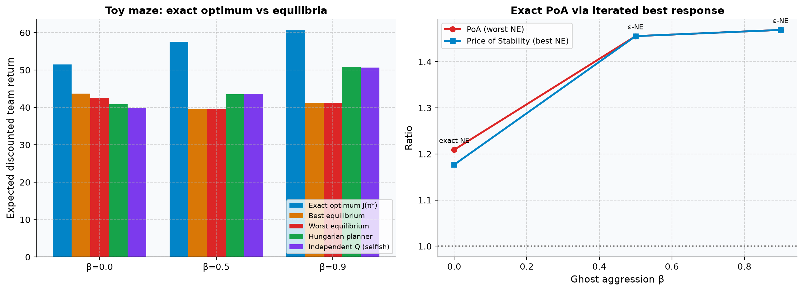
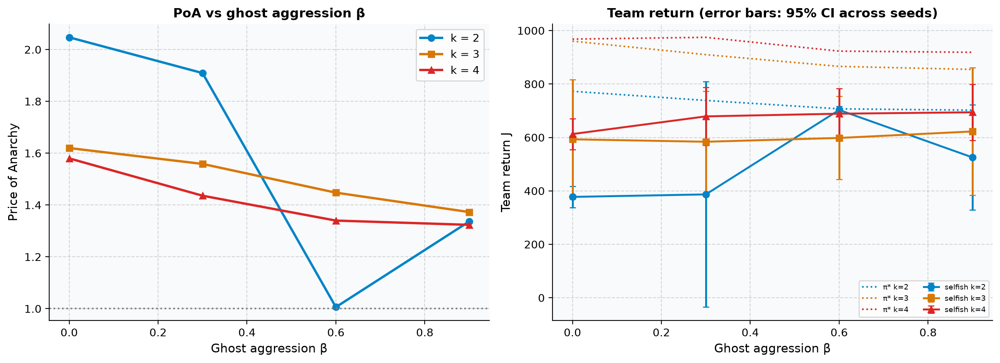
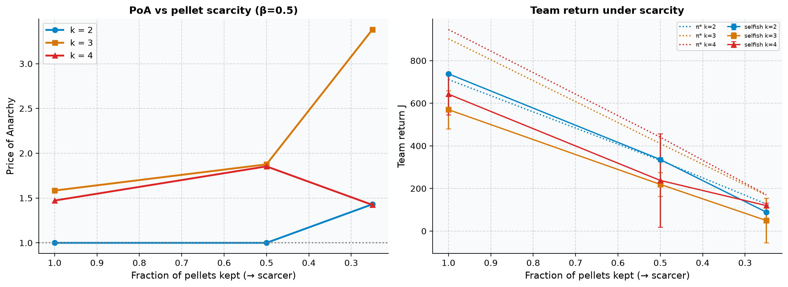
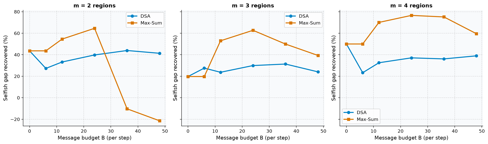
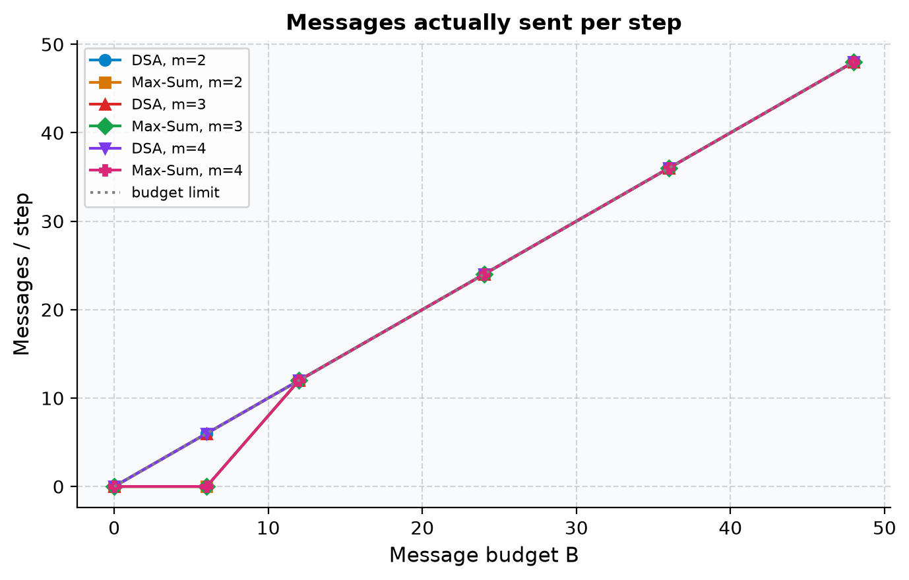
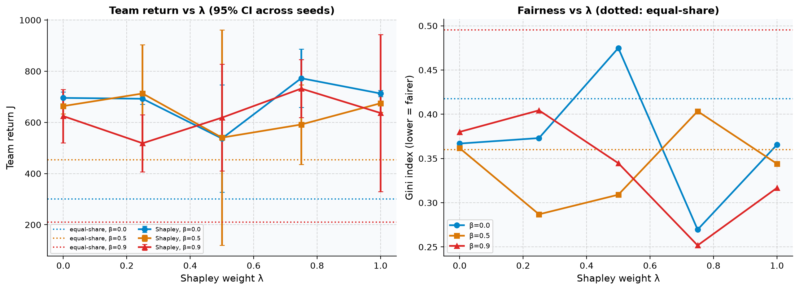
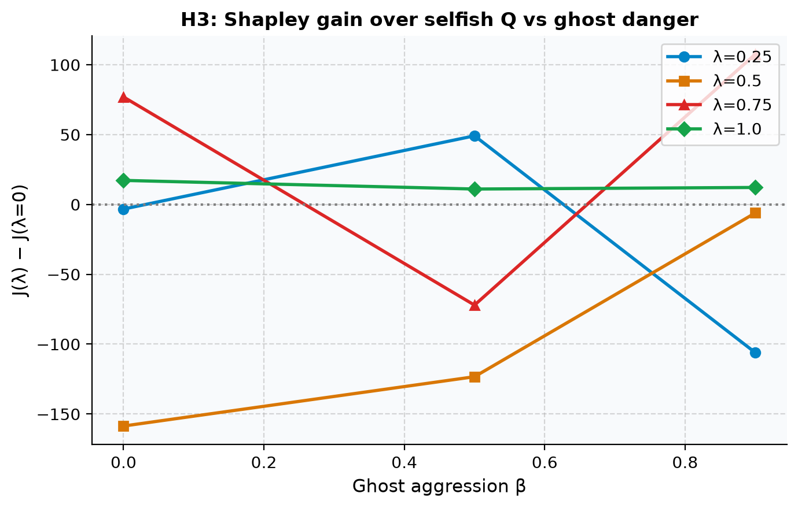
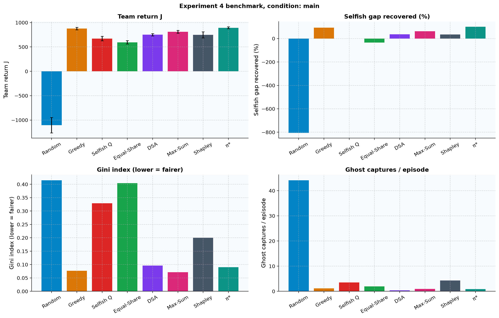
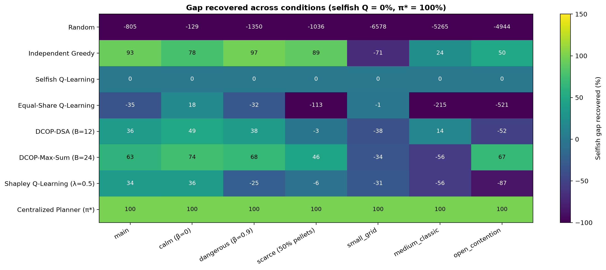

# Multi-Agent Pac-Man Testbed: Measuring and Recovering the Price of Anarchy

[](https://www.python.org/downloads/)
[](https://opensource.org/licenses/MIT)
[](https://iitgn.ac.in)
[]()
[](https://rajput-vivek-16.github.io/multi-agent-pacman-poa/)

> **CS 329: Foundations of AI: Multi-Agent Systems | Final Project Code & Testbed**  
> **Indian Institute of Technology Gandhinagar (IITGN)**  
> **Authors:**
> - **Tanuj Sharma** (23110331): `tanuj.sharma@iitgn.ac.in`
> - **Rajput Vivek** (23110269): `rajput.vivek@iitgn.ac.in`
> - **Akash KP** (23110021): `akash.kp@iitgn.ac.in`  
> *(Note: Dhruv Jalan dropped the course; his planned work on Shapley value credit assignment, reward shaping and fairness evaluation was taken over by Tanuj Sharma. Akash KP led DCOP coordination, and Rajput Vivek led the baselines, centralized planner, exact equilibrium analysis and PoA experiments.)*

---

> [!IMPORTANT]
> ### 🕹️ TEST & PLAY THE GAME DIRECTLY (Interactive Simulator & Playable Arcade)
> **You can test and play this multi-agent game right now with zero friction!**
> 
> * **🌐 Option A: Instant Web Arcade (Anyone Can Play With This Link!)**  
>   **👉 Direct Live Link: [https://rajput-vivek-16.github.io/multi-agent-pacman-poa/](https://rajput-vivek-16.github.io/multi-agent-pacman-poa/)**  
>   *(Zero setup required: works in any web browser on desktop, laptop, tablet, or smartphone! You can also double-click [**`index.html`**](index.html) or [**`play.html`**](play.html) locally).*
> 
> * **🖥️ Option B: Desktop Python GUI (75% Arcade Board / 25% Control Station)**  
>   Run the native Python Tkinter desktop application (zero external pip packages required):  
>   ```bash
>   python play_game.py
>   ```
> 
> **How to Test & Interact:**
> | Feature | How to Use | What Happens |
> | :--- | :--- | :--- |
> | **🎮 Play as P1 (Human)** | Select **`[●] 🎮 Human Player`** mode | You steer Pac-Man 1 ($P_1$, Cyan with "YOU" tag) using **Arrow Keys**, **WASD**, or the on-screen **D-Pad** (`▲`, `◄`, `⏹`, `►`, `▼`). |
> | **🤝 Pick AI Teammates** | Choose from the Teammates dropdown | Your teammates ($P_2$ to $P_k$) play with **DCOP Max-Sum**, **DCOP DSA**, **Shapley Q-Learning**, **Equal-Share Q-Learning** or **Selfish Greedy** (desktop); the web game offers a subset. |
> | **🤖 Autonomous Watch** | Select **`[●] 🤖 Autonomous AI`** mode | "YOU" tag disappears; all agents follow the selected algorithm, including the **Centralized Planner** and **Random** play. |
> | **🧪 Live Experimentation** | Use the **Experimental Controls** panel | Adjust Team Size $k$ (2 to 5), Ghosts (0 to 4 desktop, 0 to 3 web), Ghost Aggression $\beta$, DCOP Budget $B$ and Shapley $\lambda$, then click **`⚙ Apply Scenario Settings`**. |
> | **📊 Status Bar** | Watch the top statistics bar | Score, pellets left, captures, steps and the **Gini index** are computed **live**; the **Benchmark PoA** shows the value *measured in our experiments* for the selected setting ("n/a" where nothing was measured). |
> | **🏁 Game Over** | Clear the maze or reach 100 steps | A game-over panel shows **MAZE CLEARED!** or **TIME UP!**, the team score, pellets eaten, captures, Gini index, a per-player table (your row marked **P1 (YOU)**) and the top harvester. Press **↺ RESTART** / **Play Again**. |

---

## 📌 Table of Contents
1. [Executive Summary](#-executive-summary)
2. [🎮 Playable Game & Autonomous Watch Modes](#-playable-game--autonomous-watch-modes)
3. [🕹 Retro Arcade Environment & Spatial Partitioning](#-retro-arcade-environment--spatial-partitioning)
4. [🎬 Gameplay Animations & Coordination Visuals](#-gameplay-animations--coordination-visuals)
5. [📊 Benchmark Summary Table](#-benchmark-summary-table)
6. [Mathematical Formulation](#-mathematical-formulation)
   - [Game Mechanics & Contention](#game-mechanics--contention)
   - [Price of Anarchy (PoA)](#price-of-anarchy-poa)
   - [Remedy 1: DCOP-Based Region Assignment](#remedy-1-dcop-based-region-assignment)
   - [Remedy 2: Shapley-Value Reward Shaping](#remedy-2-shapley-value-reward-shaping)
7. [📈 Experimental Results & Hypothesis Verification](#-experimental-results--hypothesis-verification)
   - [Experiment 1-T: Exact PoA on a Toy Maze](#experiment-1-t-exact-poa-on-a-toy-maze-method-m1)
   - [Experiment 1: Team Size, Ghost Aggression & Pellet Scarcity](#experiment-1-team-size-ghost-aggression--pellet-scarcity-vs-poa)
   - [Experiment 2: DCOP Message Budget & Number of Regions](#experiment-2-dcop-message-budget--number-of-regions)
   - [Experiment 3: Shapley λ Across Ghost Danger](#experiment-3-shapley-λ-across-ghost-danger-h3)
   - [Experiment 4: Eight Methods Across Seven Conditions](#experiment-4-eight-methods-across-seven-conditions)
8. [📁 Project Architecture & File Organization](#-project-architecture--file-organization)
9. [⚙️ Installation & Reproducibility Guide](#️-installation--reproducibility-guide)
10. [👥 Member Contributions](#-member-contributions)
11. [📚 References](#-references)

---

## 🚀 Executive Summary

When multiple autonomous agents share a common environment with scarce resources, uncoordinated selfish behavior induces severe coordination pathologies: duplicated traversal, contention over identical resources, and failure to take collective risks. We quantify this loss using the game-theoretic **Price of Anarchy ($\mathrm{PoA}$)** in a multi-agent Pac-Man simulation environment where $k$ Pac-Men harvest a shared pool of pellets while evading dangerous ghosts.

We formulate, implement and benchmark two contrasting ways to recover the selfish performance gap:
1. **Communication-Based Coordination (DCOP)**: decentralized region assignment via **Max-Sum** (belief propagation over a factor graph) and **DSA** (Distributed Stochastic Algorithm) under a per-step message budget $B$.
2. **Incentive-Based Learning (Shapley Value)**: independent Q-learners whose rewards are shaped by exact Shapley-value credit $\varphi_i$, which needs no communication at run time.

**Key findings:**
- On a toy maze solved **exactly** (optimum by dynamic programming, Nash equilibria by iterated best response), selfish play gives an exact **PoA = 1.21**, rising to about 1.46 with aggressive ghosts.
- On the 21×15 benchmark maze, the estimated PoA reaches **3.38 under pellet scarcity**.
- **Max-Sum DCOP is the best decentralized remedy**: up to **76.6%** of the selfish gap recovered (62.8% in the main benchmark, 90.8% of the centralized return) with only 24 messages per step.
- **Shapley shaping is unreliable** with step-level credit (its effect depends strongly on the training seed), and we explain why analytically.
- A simple **greedy heuristic is a surprisingly strong baseline**, which we report openly.

---

## 🎮 Playable Game & Autonomous Watch Modes

You can run and play this game interactively or watch the AI algorithms coordinate in real time using either the **Desktop GUI** or the **Web Browser Arcade Game**:

### 1. Desktop Python GUI Game (`play_game.py`)
Built with Python's standard `tkinter` library and running the **same Python agents used in the experiments**:

```bash
python play_game.py
```

- **Adaptive 75% Board / 25% Control Station**:
  - **75% Board Canvas**: Large, arcade-sized maze with dynamic screen-scaling so the board expands and remains crisp on any monitor resolution.
  - **25% Operating Station**: Houses execution controls, on-screen D-Pad, and live experimental scenario controls.
- **Two Primary Play Modes**:
  - **`[●] 🎮 Human Player (You Control P1)`**:
    - Steer Pac-Man 1 ($P_1$, glowing Cyan with "YOU" tag) using **Arrow Keys**, **W, A, S, D**, or click the on-screen **D-Pad** (`▲`, `◄`, `⏹`, `►`, `▼`).
    - Press **PLAY** for real-time play, or keep it paused and **every key press advances one step** (turn-based).
    - Teammates ($P_2, P_3, \ldots$) coordinate alongside you via your choice of DCOP Max-Sum, DCOP DSA, Shapley Q-Learning, Equal-Share, or Selfish Greedy.
  - **`[●] 🤖 Autonomous AI (Watch Full Team)`**:
    - "YOU" tag disappears; all agents follow the selected algorithm (also Centralized Planner and Random).
- **🧪 Live Experimental Testbed Panel**:
  - Directly test conditions from Experiments 1 to 4 by tweaking:
    - **Maze Layout**: `proposal_maze` (21×15), `medium_classic`, `open_contention`, `small_grid`.
    - **Team Size ($k$)**: 2, 3, 4, or 5 Pac-Men.
    - **Ghost Count ($M$) & Hazard ($\beta$)**: 0 to 4 ghosts; aggression parameter $\beta \in [0.0, 1.0]$.
    - **DCOP Budget ($B$)**: 0 to 48 messages per step.
    - **Shapley Weight ($\lambda$)**: $0.0$ (Selfish) to $1.0$ (Pure Shapley).
    - Click **`⚙ Apply Scenario Settings`** to immediately reload and test the customized scenario!
- **Status bar**: Score, pellets left, ghost captures, step counter and Gini index are computed **live** from the game. **Benchmark PoA** shows the PoA *measured in our experiments* for the selected algorithm, layout and budget (it needs many trained episodes, so it cannot be computed from one game) and shows "n/a" for unmeasured settings such as human play or $k \neq 3$.
- **Pac-Man faces its direction of travel**: each mouth points the way that Pac-Man last moved.
- **Game-over panel** when all pellets are eaten or 100 steps are reached: result title, team score, pellets eaten, captures, Gini index, a per-player table and the top harvester. **↺ RESTART** starts a fresh game.

### 2. Standalone Web Browser Game (`play.html`)
- Open [**`play.html`**](play.html) directly in any web browser (Chrome, Edge, Firefox, Safari), or use the live link above (GitHub Pages serves the identical `index.html`).
- HTML5 Canvas, zero dependencies, on-screen D-Pad and keyboard controls, 2 to 5 Pac-Men and 0 to 3 ghosts, live Gini and per-agent returns, benchmark PoA and gap values from the experiments, and the same game-over panel.
- **Note:** the browser AI teammates are simplified JavaScript imitations of each algorithm. All numbers in the results come from the Python implementation.

---

## 🕹 Retro Arcade Environment & Spatial Partitioning

<p align="center">
  
  <br>
  <em>Figure 1: The 21×15 benchmark maze (matching Figure 1 of the project proposal) with 3 vertical sectors (Region A, Region B, Region C) separated by dashed lines, 3 Pac-Men ($P_1, P_2, P_3$), 2 ghosts ($G_1, G_2$), 149 pellets and 4 larger corner pellets (every pellet is worth +10).</em>
</p>

### Environmental Characteristics
- **Graph Representation**: Undirected connected graph $G = (V, E)$ with 156 open cells (including the ghost house) and 149 pellets.
- **Regions for DCOP**:
  - **Region A ($R_1$)**: Columns $1 \le x \le 6$ (48 open cells, West sector).
  - **Region B ($R_2$)**: Columns $7 \le x \le 13$ (60 open cells, Central sector with ghost house).
  - **Region C ($R_3$)**: Columns $14 \le x \le 19$ (48 open cells, East sector).
- **Rewards**: $+10$ per pellet, $-1$ per step for each Pac-Man, $-50$ when caught; episodes end when the maze is cleared or after $T = 100$ steps; returns are discounted with $\gamma = 0.99$.
- **Contention Mechanics**: When multiple Pac-Men enter the same pellet cell simultaneously, exactly one agent is chosen uniformly at random to receive the $+10$ reward, while the others gain nothing.
- **Ghost Danger**: Ghosts pursue the nearest Pac-Man along shortest graph paths with probability $\beta$ (otherwise they move randomly); a Pac-Man caught on the same cell or by swapping cells gets $-50$ and respawns at its start.
- **Pellet Scarcity**: an option keeps only a fixed random fraction of pellets (the same subset for every method), used to test H1.
- **Six layouts**: `proposal_maze`, `toy_exact` (exact analysis), `toy`, `small_grid`, `medium_classic`, `open_contention`.

---

## 🎬 Gameplay Animations & Coordination Visuals

Illustrative recordings of single episodes (generated by `generate_animations.py`; for measured performance see the results below):

### Side-by-Side: Selfish Play vs. DCOP Coordinated Play
<p align="center">
  
  <br>
  <em>Figure 2: Side-by-side gameplay. <b>Left:</b> selfish agents chase the same nearby pellets and overlap. <b>Right:</b> DCOP Max-Sum assigns agents to Regions A, B and C so they harvest in parallel with far less overlap.</em>
</p>

### DCOP Coordinated Max-Sum & Shapley Q-Learning Gameplay
<p align="center">
  
  &nbsp;&nbsp;
  
  <br>
  <em>Figure 3: <b>Left:</b> DCOP Max-Sum agents sweeping their assigned regions. <b>Right:</b> Shapley-shaped Q-learning agents (λ = 0.5).</em>
</p>

---

## 📊 Benchmark Summary Table

Main condition: 21×15 benchmark maze, k = 3 Pac-Men, 2 ghosts, β = 0.5. 20 evaluation episodes per configuration; every learned method is trained with **3 seeds** and the episodes are pooled. "Gap recovered" is 0% for selfish Q-learning and 100% for the centralized planner (negative = worse than selfish).

| Method | Paradigm | Team Return $J$ | 95% CI | Est. PoA | Gap Recovered | Gini | Msgs/step |
| :--- | :---: | :---: | :---: | :---: | :---: | :---: | :---: |
| Random | Uncoordinated | $-1105.2$ | $\pm 157.1$ | n/a | $-805.2\%$ | $0.415$ | 0 |
| Selfish Q-Learning ($\lambda=0$) | Independent MARL | $672.6$ | $\pm 44.5$ | $1.328$ | $0\%$ (ref) | $0.329$ | 0 |
| Independent Greedy | Local heuristic | $877.1$ | $\pm 24.3$ | $1.019$ | $92.6\%$ | $0.077$ | 0 |
| Equal-Share Q-Learning | Naive sharing | $595.2$ | $\pm 34.6$ | $1.501$ | $-35.0\%$ | $0.404$ | 0 |
| DCOP-DSA ($B=12$) | Communication | $751.1$ | $\pm 23.7$ | $1.189$ | $35.6\%$ | $0.096$ | 12 |
| **DCOP-Max-Sum ($B=24$)** | Communication | **$811.3$** | $\pm 29.3$ | **$1.101$** | **$62.8\%$** | **$0.071$** | 24 |
| Shapley Q-Learning ($\lambda=0.5$) | Incentive MARL | $748.6$ | $\pm 63.6$ | $1.193$ | $34.4\%$ | $0.200$ | 0 |
| Centralized Planner ($\hat\pi^\star$) | Hungarian matching | $893.4$ | $\pm 19.1$ | $1.000$ | $100\%$ | $0.090$ | 0 |

*Honest caveat:* the plain greedy heuristic recovers more of the gap than either remedy, which mainly shows that short-trained independent Q-learners are a weak selfish reference. Results across 7 conditions are in [Experiment 4](#experiment-4-eight-methods-across-seven-conditions).

---

## 📐 Mathematical Formulation

### Return and Social Welfare
For joint policy $\pi = (\pi_1, \dots, \pi_k)$, the expected discounted return of agent $i$ is:
$$J_i(\pi) = \mathbb{E}_\pi \left[ \sum_{t=0}^{T-1} \gamma^t r_i(s_t, a_t, s_{t+1}) \right], \quad J(\pi) = \sum_{i \in \mathcal{N}} J_i(\pi)$$

The social optimum $\pi^\star$ maximizes total team return:
$$\pi^\star \in \arg\max_\pi J(\pi)$$

The set of Nash equilibria $\Pi_{\mathrm{NE}}$ contains joint policies where no individual agent can strictly profit by unilateral deviation:
$$\Pi_{\mathrm{NE}} = \{ \pi : J_i(\pi_i, \pi_{-i}) \ge J_i(\pi'_i, \pi_{-i}), \quad \forall i \in \mathcal{N}, \; \forall \pi'_i \}$$

### Price of Anarchy (PoA)
$$\mathrm{PoA} = \frac{J(\pi^\star)}{\min_{\pi \in \Pi_{\mathrm{NE}}} J(\pi)}$$
By definition, $\mathrm{PoA} \ge 1.0$, where $\mathrm{PoA} = 1.0$ indicates zero efficiency loss from selfish behavior, and larger values reflect severe coordination failures.

### Remedy 1: DCOP-Based Region Assignment
The maze is partitioned into $m$ regions $R_1, \dots, R_m$. Each Pac-Man $i$ selects region variable $z_i \in \{1, \dots, m\}$ to minimize:
$$f_i(z_i; s) = -\rho \frac{|P \cap R_{z_i}|}{1 + d(x^i, \bar{c}_{z_i})} + c \sum_{j \in \mathcal{M}} \mathbf{1}[d(y^j, R_{z_i}) \le \zeta] + \eta \sum_{l \neq i} \mathbf{1}[z_l = z_i]$$
Subject to an explicit communication constraint:
$$z^\star(s) \in \arg\min_{z \in \{1, \dots, m\}^k} \sum_{i \in \mathcal{N}} f_i(z_i; s), \quad \text{using at most } B \text{ messages per step}$$

### Remedy 2: Shapley-Value Reward Shaping
To resolve the credit-assignment dilemma, agent $i$'s reward is shaped using its exact Shapley value marginal contribution across all coalitions $S \subseteq \mathcal{N} \setminus \{i\}$:
$$\varphi_i(\pi) = \sum_{S \subseteq \mathcal{N} \setminus \{i\}} \frac{|S|! (k - |S| - 1)!}{k!} [v(S \cup \{i\}) - v(S)]$$
$$U_i^\lambda(\pi) = (1 - \lambda) J_i(\pi) + \lambda \varphi_i(\pi), \quad \lambda \in [0, 1]$$

---

## 📈 Experimental Results & Hypothesis Verification

| Hypothesis | Verdict |
| :--- | :--- |
| **H1**: PoA grows with team size and pellet scarcity | **Partly supported**: yes for scarcity, no for team size |
| **H2**: DCOP recovers much of the gap with a small budget | **Supported for Max-Sum** (best at $B=24$; more messages hurt) |
| **H3**: Shapley helps more when ghosts are dangerous | **Not statistically supported** (right direction, but seed variance exceeds the gain) |
| Success criterion: clear PoA > 1 and one remedy recovers a meaningful share | **Met** (Max-Sum DCOP) |

### Experiment 1-T: Exact PoA on a Toy Maze (Method M1)
<p align="center">
  
</p>

On the 5×5 ring maze `toy_exact` (2 Pac-Men, 1 ghost, 7 pellets, horizon 12) the whole joint state space (37,550 states) is enumerated. The **exact team optimum** is solved by dynamic programming, **exact best responses** are computed against fixed opponents, and **Nash equilibria** are found by iterated best response from 5 starting profiles ([src/exact_solver.py](src/exact_solver.py)).

| β | Exact $J(\pi^\star)$ | Equilibrium found | Worst NE | **PoA** | PoS | Hungarian planner vs exact optimum |
| :---: | :---: | :--- | :---: | :---: | :---: | :---: |
| 0.0 | 51.48 | exact pure NE (5/5 starts) | 42.57 | **1.209** | 1.177 | 79.4% |
| 0.5 | 57.56 | ε-NE (ε = 1.42) | 39.54 | 1.456 | 1.456 | 75.6% |
| 0.9 | 60.59 | ε-NE (ε = 0.33) | 41.24 | 1.469 | 1.469 | 83.8% |

- **Why selfish play misses the optimum:** the team-optimal policy is not an equilibrium. One Pac-Man can raise its own return by deviating (by 7.0 at β=0, by 16.0 and 17.5 at β=0.5 and 0.9), so selfish best responses move away from it.
- At β=0, IBR converges from all 5 starts to **5 different pure equilibria** (42.57 to 43.74), all below the optimum (51.48); even the best equilibrium loses 15% (PoS = 1.177).
- With ghost pressure, best responses cycle from every start, so no pure equilibrium was found and the smallest-gap ε-equilibrium is reported (labelled as such).
- The exact model matches the simulator: replaying $\pi^\star$ in the real environment reproduces its value within 0.2.
- The Hungarian planner reaches only 76 to 84% of the true optimum (on this maze it is no better than selfish Q-learning), so every PoA estimated on large mazes is an **underestimate**.
- Independent Q-learning gives PoA estimates of 1.29, 1.32 and 1.20 here: close to the exact value at β=0, but with ghosts it scores above the ε-equilibria, so it understates the worst case.

---

### Experiment 1: Team Size, Ghost Aggression & Pellet Scarcity vs. PoA
<p align="center">
  
  
</p>

| Est. PoA | β=0.0 | β=0.3 | β=0.6 | β=0.9 | 100% pellets | 50% | 25% |
| :--- | :---: | :---: | :---: | :---: | :---: | :---: | :---: |
| k=2 | 2.047 | 1.909 | 1.006 | 1.337 | 1.000 | 1.000 | 1.431 |
| k=3 | 1.620 | 1.559 | 1.448 | 1.373 | 1.584 | 1.876 | **3.381** |
| k=4 | 1.580 | 1.436 | 1.340 | 1.323 | 1.472 | 1.854 | 1.424 |

- **Scarcity raises PoA** (k=3: 1.58 → 1.88 → 3.38). **Team size does not**: PoA is highest for k=2.
- The k=2 row is the least reliable: selfish learning varies strongly between training seeds (at β=0.3 the three seeds score 760, 14 and 387).
- PoA falls with β on this maze, while the exact toy analysis shows the opposite, so the β trend on the large maze is treated as inconclusive.

---

### Experiment 2: DCOP Message Budget & Number of Regions
<p align="center">
  
  
</p>

Gap recovered (%) for $m \in \{2,3,4\}$ regions; all budgets for a given $m$ use the same episodes (common random numbers).

| | B=0 | 6 | 12 | 24 | 36 | 48 |
| :--- | :---: | :---: | :---: | :---: | :---: | :---: |
| Max-Sum, m=2 | 43.6 | 43.6 | 54.5 | **64.6** | −10.3 | −21.4 |
| Max-Sum, m=3 | 19.7 | 19.7 | 52.9 | **62.7** | 49.9 | 39.3 |
| Max-Sum, m=4 | 50.0 | 50.0 | 70.0 | **76.6** | 75.1 | 59.6 |
| DSA, m=3 | 19.7 | 27.6 | 23.7 | 29.9 | 31.3 | 24.1 |

- Max-Sum needs 12 messages for one iteration (k=3), so B=6 equals no communication.
- Even with **no communication (B=0)**, region-focused agents recover 20 to 50% of the gap.
- Max-Sum peaks at **B=24 for every m** (up to **76.6%** with 4 regions). More messages hurt, likely because loopy max-sum on the fully connected factor graph overshoots without damping; with m=2 (fewer regions than agents) the assignment collapses.
- More regions help Max-Sum, because every agent can get a conflict-free region.
- DSA stays at 20 to 44% regardless of budget.

---

### Experiment 3: Shapley λ Across Ghost Danger (H3)
<p align="center">
  
  
</p>

| Team return (±95% CI across seeds) | λ=0 | 0.25 | 0.5 | 0.75 | 1.0 | Equal-share |
| :--- | :---: | :---: | :---: | :---: | :---: | :---: |
| β=0.0 | 695.7 ±24 | 692.4 ±21 | 537.1 ±210 | **772.6** ±114 | 712.9 ±12 | 300.8 |
| β=0.5 | 663.8 ±31 | **712.9** ±191 | 540.5 ±421 | 591.7 ±156 | 674.8 ±36 | 454.3 |
| β=0.9 | 624.6 ±104 | 518.5 ±112 | 618.5 ±209 | **732.1** ±114 | 636.7 ±307 | 210.4 |

- The best shaped policy beats selfish learning at every β, with the biggest gain at β=0.9 (+107.5), but the best λ keeps changing and seed variance (up to ±421) is larger than the gains.
- Equal-share is the worst method at every β.
- **Why the effect is weak:** with step-level credit, the Shapley value splits a contested pellet equally, which equals the *expected* reward of the random-winner rule. So shaping mostly reduces variance instead of changing incentives. Trajectory-level counterfactual credit would be needed.

---

### Experiment 4: Eight Methods Across Seven Conditions
<p align="center">
  
  
</p>

Gap recovered (%):

| Condition | Greedy | Equal-share | DSA | **Max-Sum** | Shapley |
| :--- | :---: | :---: | :---: | :---: | :---: |
| main (β=0.5) | 92.6 | −35.0 | 35.6 | **62.8** | 34.4 |
| calm (β=0) | 77.6 | 17.9 | 48.7 | **74.5** | 36.4 |
| dangerous (β=0.9) | 96.7 | −31.9 | 38.0 | **67.9** | −25.3 |
| scarce (50% pellets) | 88.7 | −113.2 | −2.9 | **45.5** | −6.3 |
| `small_grid` | −70.7 | −1.4 | −37.6 | −34.0 | −31.4 |
| `medium_classic` | 23.7 | −214.7 | 13.9 | −56.3 | −55.5 |
| `open_contention` | 49.6 | −521.1 | −52.0 | **67.3** | −87.0 |

- **Max-Sum is the best decentralized remedy**: 45 to 75% on the benchmark maze in every setting, 67% on `open_contention`, 90.8% of the centralized return with 24 messages/step.
- DCOP agents are caught least (0.35 and 0.95 captures per episode vs 3.52 for selfish Q); Shapley Q is caught most (4.33), which hurts it when ghosts are aggressive.
- Shapley shaping helps in calm conditions but hurts under danger and scarcity. Equal-share is consistently harmful.
- Smaller layouts differ: on `small_grid` no method except the planner beats selfish learning, and on `medium_classic` only greedy (+23.7%) and DSA (+13.9%) do. The selfish gap there is only 32 to 40 points, so percentages swing a lot. The larger `open_contention` behaves like the main maze.

---

## 📁 Project Architecture & File Organization

```
multi-agent-pacman-poa/
├── play_game.py                   # Desktop Python GUI game (Arrow keys / WASD)
├── play.html / index.html         # Browser arcade game (GitHub Pages)
├── run_all.py                     # Runs everything (--quick for a smoke test, --only to pick stages)
├── visualize.py                   # Maze renderer (Figure 1)
├── generate_animations.py         # Gameplay GIF generator
├── requirements.txt               # numpy, scipy, matplotlib, pandas, pillow
├── src/
│   ├── environment.py             # Multi-agent Pac-Man environment (pellet scarcity option)
│   ├── layouts.py                 # proposal_maze, toy_exact, toy, small_grid, medium_classic, open_contention
│   ├── ghosts.py                  # Ghost policy with aggression beta
│   ├── baselines.py               # Random, greedy, Hungarian centralized planner
│   ├── exact_solver.py            # Exact optimum, best responses, iterated best response, PoA/PoS (toy maze)
│   ├── dcop.py                    # Region partitioning, DSA and Max-Sum under a message budget
│   ├── shapley.py                 # Exact Shapley credit (2^k coalitions)
│   ├── q_learning.py              # Linear approximate Q-learning agents
│   ├── trainer.py                 # Training, multi-seed evaluation, messages/step metric
│   └── metrics.py                 # PoA, Gini, gap recovered, 95% CI
├── experiments/
│   ├── common.py                  # Plot style, saving, JSON helpers
│   ├── run_experiment_toy_ne.py   # Exp 1-T: exact PoA on toy maze
│   ├── run_experiment_1.py        # Exp 1: PoA vs k, beta, pellet scarcity
│   ├── run_experiment_2.py        # Exp 2: DCOP budget B x regions m
│   ├── run_experiment_3.py        # Exp 3: Shapley lambda x beta (H3)
│   └── run_experiment_4.py        # Exp 4: 8 methods x 7 conditions
├── results/                       # JSON / CSV outputs
└── plots/                         # All figures (PNG) and gameplay GIFs
```

---

## ⚙️ Installation & Reproducibility Guide

### 1. Installation
```bash
git clone https://github.com/Rajput-Vivek-16/multi-agent-pacman-poa.git
cd multi-agent-pacman-poa
python -m venv venv
.\venv\Scripts\activate      # Windows
source venv/bin/activate     # Linux / macOS
pip install -r requirements.txt
```

### 2. Interactive Gameplay
```bash
python play_game.py          # desktop GUI
# or open play.html in a browser
```

### 3. Reproduce All Results
```bash
python run_all.py --quick                 # 2 to 3 minute smoke test
python run_all.py                         # full run (all figures, GIFs, results)
python run_all.py --only toy e1 e2 e3 e4  # experiments only (about 20 to 30 minutes)
```

Each experiment can also be run on its own, e.g. `python experiments/run_experiment_toy_ne.py`. All randomness is seeded; Q-learning results can still vary slightly between machines. All figures are written to `plots/` and all numbers to `results/`.

---

## 👥 Member Contributions

| Member | Proposal Task Allocation | Final Status & Implementation Highlights |
| :--- | :--- | :--- |
| **Tanuj Sharma** (23110331) | Multi-Pac-Man simulator, maze layouts, ghost policies, interactive GUI, and **Shapley Value Module (Dhruv Jalan's Work Absorbed)**: exact Shapley credit assignment, reward shaping, free-rider analysis, and fairness evaluation (Exp 3). | **Completed**: Built `MultiAgentPacmanEnv` with custom shallow cloning, `proposal_maze` (21×15), parametric ghost policies (`ghosts.py`), interactive GUI game (`play_game.py`), web game (`play.html`), exact Shapley credit calculator (`shapley.py`), Shapley Q-learning training pipeline, Gini fairness index, and Experiment 3 suite. |
| **Rajput Vivek** (23110269) | Independent Q-learning baseline, centralized planner, toy-maze equilibrium computation, PoA analysis, Exp 1 & 4. | **Completed**: Implemented Hungarian matching centralized planner (`baselines.py`), independent Q-learning agent (`q_learning.py`), **exact toy-maze optimum and iterated best response equilibria** (`exact_solver.py`, Exp 1-T), PoA metric calculator, Experiment 1 & 4 benchmark suites (multi-seed, pellet scarcity, 7 conditions), and publication plotting. |
| **Akash KP** (23110021) | DCOP module (Max-Sum, DSA), region partitioning, message budget analysis, Exp 2. | **Completed**: Implemented Voronoi and vertical column spatial partitioner, DCOP cost model with DSA and Max-Sum belief propagation solvers (`dcop.py`), message budget scaling, and Experiment 2 suite (budget × number of regions, messages per step). |

*(Note: Dhruv Jalan's originally assigned tasks on Shapley value credit assignment, marginal contribution calculation, and fairness analysis were fully absorbed, implemented, and delivered by Tanuj Sharma).*

---

## 📚 References
1. E. Koutsoupias and C. Papadimitriou. *Worst-case equilibria*. In STACS, 1999.
2. T. Roughgarden and É. Tardos. *How bad is selfish routing?* Journal of the ACM, 49(2), 2002.
3. L. S. Shapley. *A value for n-person games*. Contributions to the Theory of Games II, Princeton University Press, 1953.
4. M. L. Littman. *Markov games as a framework for multi-agent reinforcement learning*. In ICML, 1994.
5. A. Farinelli, A. Rogers, A. Petcu, and N. R. Jennings. *Decentralised coordination of low-power embedded devices using the max-sum algorithm*. In AAMAS, 2008.
6. F. Fioretto, E. Pontelli, and W. Yeoh. *Distributed constraint optimization problems and applications: A survey*. Journal of Artificial Intelligence Research, 61, 2018.
7. W. Zhang, G. Wang, Z. Xing, and L. Wittenburg. *Distributed stochastic search and distributed breakout for constraint optimization problems in sensor networks*. Artificial Intelligence, 161(1-2), 2005.
8. J. Wang, Y. Zhang, T.-K. Kim, and Y. Gu. *Shapley Q-value: A local reward approach to solve global reward games*. In AAAI, 2020.
9. J. Foerster et al. *Counterfactual multi-agent policy gradients*. In AAAI, 2018.
10. J. DeNero and D. Klein. *Teaching introductory artificial intelligence with Pac-Man*. In EAAI, 2010.
11. UC Berkeley CS188 Pac-Man Projects. `https://ai.berkeley.edu`.
